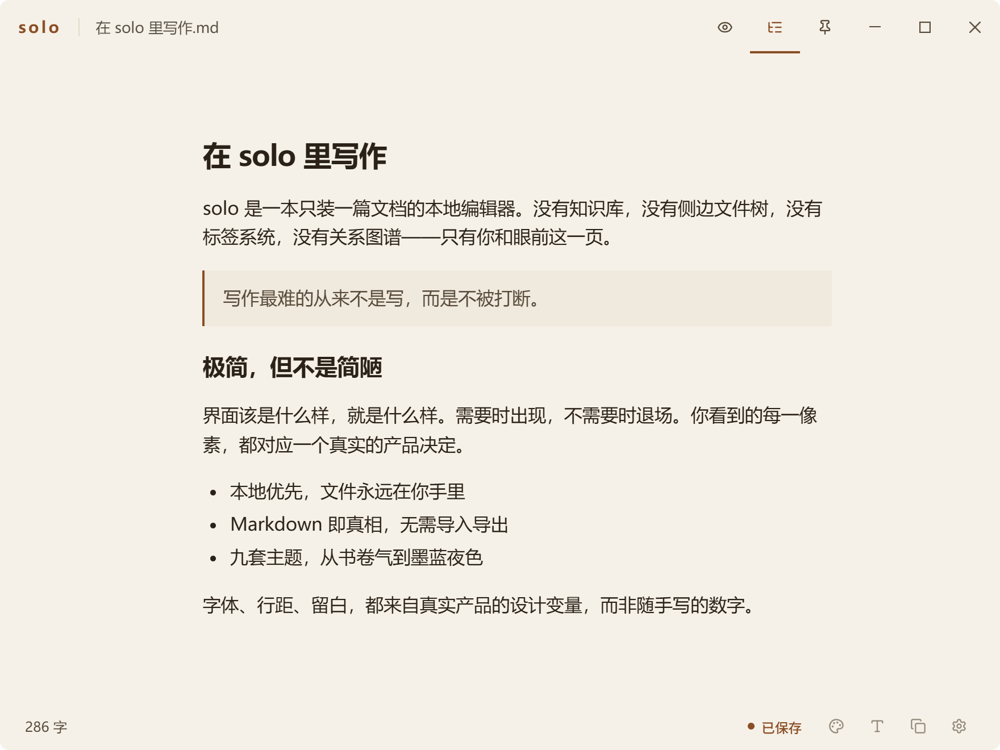
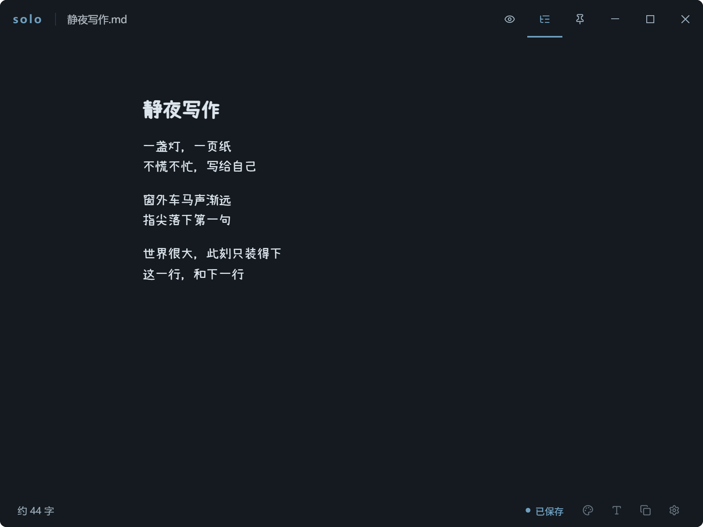
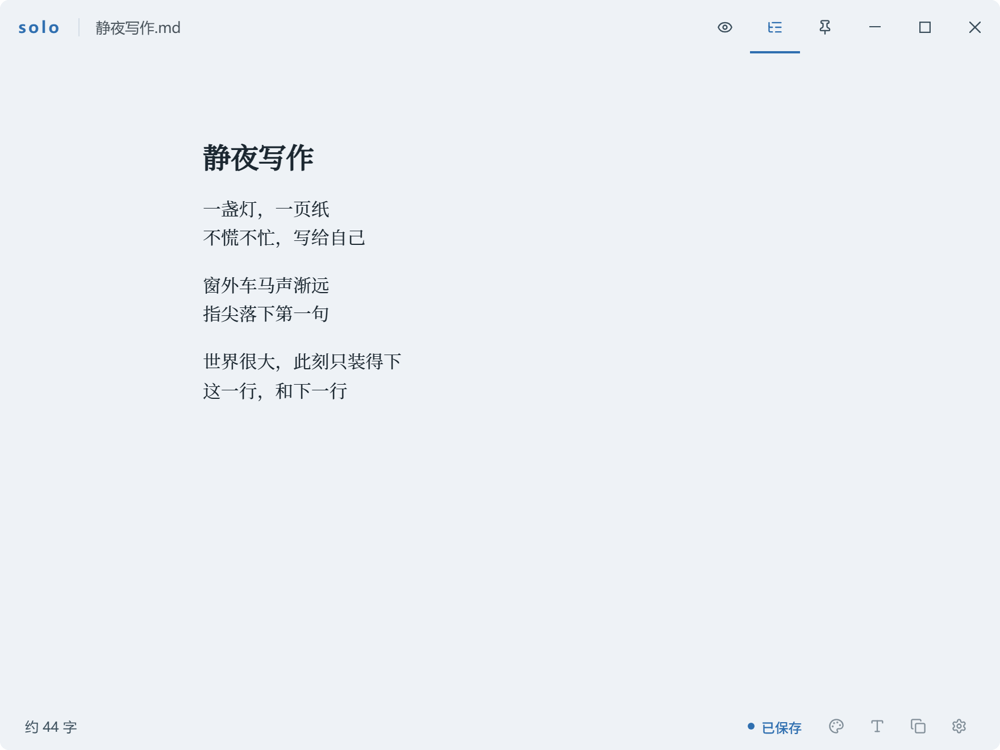
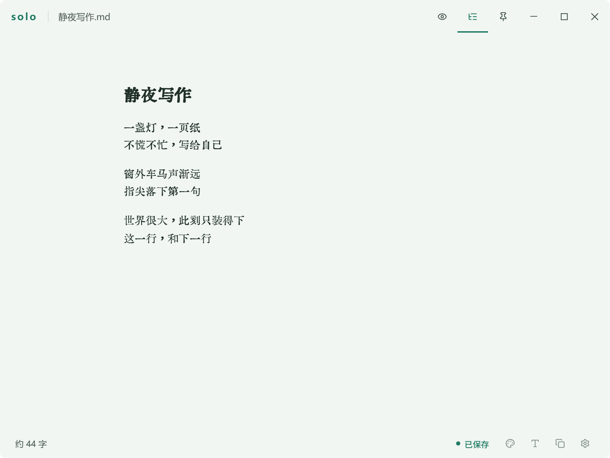
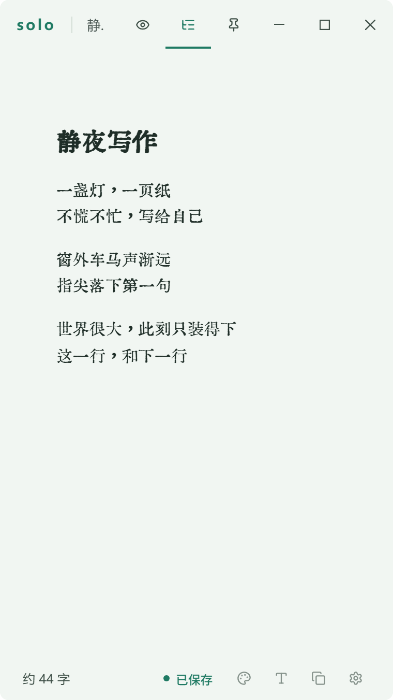

<p align="center">
  
</p>

<h1 align="center">solo</h1>

<p align="center">
  <strong>Local-first, minimalist Markdown editor for immersive writing</strong>
</p>

<p align="center">
  <a href="https://solo.weimabbs.com/">🌐 Official Website</a>
  ·
  <a href="./README.md">English</a>
  ·
  <a href="./README.zh-CN.md">简体中文</a>
  ·
  <a href="./README.ja-JP.md">日本語</a>
  ·
  <a href="./README.ko-KR.md">한국어</a>
</p>

<p align="center">
  
  
  
  
</p>

## Screenshots

<p align="center">
  
</p>

<table align="center">
  <tr>
    <td></td>
    <td></td>
    <td></td>
  </tr>
</table>

<p align="center">
  
</p>

## What is solo?

solo is a free, open-source Markdown editor for Windows. A "scalpel for words" — launches instantly, stays out of your way, and works directly on local `.md` files. It is not a note-taking app, not a knowledge base, and not a platform.

## Features

- **WYSIWYG editing** — TipTap / ProseMirror under the hood. Type and see it rendered instantly.
- **Multi-window** — Open multiple files in separate windows. Switch focus without losing content. Compare documents side-by-side.
- **Extended syntax** — KaTeX math, Mermaid diagrams, GFM tables, footnotes, Frontmatter YAML, Callouts (12 types, 8 colors), WikiLinks, highlighting, superscript/subscript.
- **Elegant typography** — 8 hand-crafted themes (Scholar Light / Scholar Dark / Elegant / Cinnabar / Cinnabar Dark / Default / Jade / Orchid), fully themeable. Fonts downloaded on demand.
- **Desktop-native** — Frameless window, system menu, right-click "New .md", double-click titlebar to maximize, always-on-top. Auto-save is optional (off by default).
- **Memory-conscious** — WebView2 MemoryUsageTargetLevel on blur, lazy editor initialization, lightweight installer (uses system WebView2).
- **Copy as HTML** — One-click rich HTML to clipboard, theme-following, what you see is what you get.
- **Format fidelity** — Full Markdown round-trip tests + CommonMark spec stability checks (run `bun run test` for the current count). Paste Markdown auto-converts. Ctrl+C copies clean text (the Markdown source is used only when the selection contains formulas / diagrams / wikilinks etc.); use **Copy as Markdown** (Mod+Shift+M) when you want the source.

## Tech Stack

Tauri 2 (Rust) → Vue 3 + Pinia + TipTap/ProseMirror + Tailwind CSS 4

## Install

Download the latest installer from [Releases](https://github.com/jloft198479-cyber/solo/releases). Custom install path supported.

After first launch, enable Windows file association in Settings for right-click "New .md".

## Development

```bash
bun install
bun run dev          # Frontend only
bun run dev:tauri    # Full-stack with Tauri
bun run build:tauri  # Build installer
bun run test         # Run tests
```

Requires Rust 1.96+ and MSVC Build Tools.

> **AI agents / contributors:** all project rules (prohibitions, source-of-truth map, sensitive areas) live in [`AGENTS.md`](./AGENTS.md) — read it before making changes.

## Contact

- Official website: <https://solo.weimabbs.com/>
- WeChat: fzz198479

## License

solo is open-sourced under [Apache License 2.0](LICENSE), forked from [MarkLight](https://github.com/xiaodou997/marklight).
